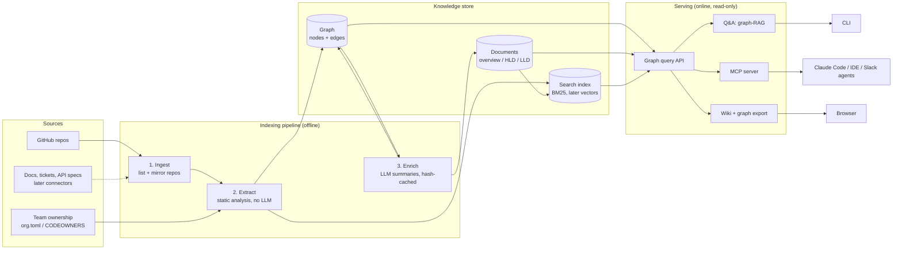

# Org Knowledge Graph — architecture, scaling and cost

## 1. Problem

When work spills into a team you have never worked with, you currently need a person to walk you
through their product and point you at the right repo. That costs the newcomer days and the owning
team an hour of repeating the basics.

The knowledge graph gives every engineer a self-serve answer to three questions:

| Question | Who asks | Served by |
|---|---|---|
| "What does this team own and what does each repo do?" | new joiner | team brief, repo list |
| "How is this product built and how does a request flow through it?" | new joiner, cross-team dependant | HLD / LLD per repo |
| "Who already uses X / solved Y, and what should I know before I ask them?" | anyone crossing a team boundary | search, `who_uses`, related repos, Q&A |

The goal is not to replace the conversation with the owning team, but to move it past the basics
so it starts at the edge cases.

## 2. High-level design

### The one design decision that matters

**Structure is extracted, explanations are generated.**

- *Extracted* (deterministic, free, exact): which files exist, what they import, which classes and
  endpoints they define, which libraries they use, who owns the repo. This is read off the code,
  so it cannot be hallucinated and costs nothing to recompute.
- *Generated* (LLM, paid, fallible): what the repo is for, its components and flow, per-module
  design notes, the concepts you need to know. The LLM is handed the extracted structure and asked
  to explain it — and every path it cites is checked against the real file tree before it is
  stored (`apply_repo` in `orgkg/enrich.py`).

This split is what keeps the system cheap and trustworthy at scale: the LLM only runs on content
that changed, and it can never invent a file, a dependency or an owner.

### Graph model

| Node | Source | Example |
|---|---|---|
| `org`, `team` | config / ownership system | `team:ml-engineering` |
| `repo` | GitHub API | `repo:mini-cdn` |
| `module`, `file` | file tree | `file:mini-cdn/cdn-server/.../ProxyService.java` |
| `symbol` | AST / regex | `sym:…#ProxyService` (class, methods, docstring) |
| `endpoint` | route decorators / Spring mappings | `api:mini-cdn/DELETE /admin/cache` |
| `tech` | manifests + imports | `tech:spring-boot`, `tech:mlflow` |
| `component` | LLM (grounded to paths) | `comp:mini-cdn/lrutlcache` |
| `concept` | LLM | `concept:consistent-hashing` |

| Edge | Meaning |
|---|---|
| `HAS_TEAM`, `OWNS`, `CONTAINS`, `DEFINES`, `EXPOSES` | the containment hierarchy org → team → repo → module → file → symbol/endpoint |
| `IMPORTS` | file → file inside a repo (the internal dependency graph) |
| `USES`, `WRITTEN_IN` | file/repo → technology |
| `HAS_COMPONENT`, `IMPLEMENTED_BY`, `FLOWS_TO` | the HLD as graph: components, the code behind them, and what flows between them |
| `ABOUT` | repo → concept |

Cross-team links fall out of shared nodes: two repos in different teams that both point at
`tech:mlflow` or `concept:data-drift` are one hop apart, which is what `related_repos` and
`who_uses` exploit.

### Indexing pipeline

1. **Ingest** (`ingest.py`) — list the owner's repos through the GitHub API and shallow-mirror them.
   Repo contents are only read, never executed.
2. **Extract** (`extract.py`) — walk each repo; parse Python with `ast`, notebooks cell by cell,
   Java/Swift/C++/JS with targeted regexes; read manifests (`requirements.txt`, `pom.xml`, Gradle,
   `package.json`, Dockerfiles, workflows). A repo is re-extracted only when its HEAD commit changed.
3. **Enrich** (`enrich.py`) — build a digest per repo (tree, README, dependencies, endpoints, import
   graph, symbol outline, the most central source files) and ask the LLM for a structured
   overview / HLD / LLD. Repos too large for one prompt are map-reduced: one call per module, then
   one call over the module summaries. Finally one call per team writes the team brief from its
   repo overviews. Every call is cached under `hash(prompt version, model, digest)`.

### Serving

- **Graph query API** (`query.py`) — the single read path: `list_teams`, `list_repos`, `team_brief`,
  `repo_doc(level)`, `repo_structure`, `explain_path`, `search`, `who_uses`, `related_repos`.
- **Q&A** (`ask.py`) — graph-RAG: link the teams/repos/technologies named in the question to
  nodes, add BM25 hits, expand to the owning repo's overview/HLD (and LLD for "how does it work"
  questions), then one LLM call answers with citations.
- **MCP server** (`mcp_server.py`) — exposes the query API as tools, so any agent (Claude Code,
  an IDE, a Slack bot) can navigate the org itself. This is the main integration point: the graph
  is the product, agents are clients.
- **Exports** (`wiki.py`) — a markdown wiki (team → repo → HLD/LLD) and an interactive graph page.

## 3. What the POC covers

Scope: the 21 public repos of `github.com/BadagiAnanya`, grouped into five stand-in teams in
`config/org.toml` (Backend Platform, ML Engineering, Generative AI, Mobile, Internal Tools).

Measured on the run of 13 October 2026:

| Stage | Result |
|---|---|
| Ingest | 21 repos listed, 19 mirrored (2 are empty), 34 MB |
| Extract | 228 files, 223 symbols, 107 modules, 68 technologies, 9 HTTP endpoints, 127 internal import edges — about 2 seconds, no LLM |
| Enrich | 19 repo documents (overview + HLD + LLD) and 5 team briefs in 24 LLM calls; 79 components and 98 concepts added to the graph |
| Grounding | 1 model-cited path did not exist in the real tree and was dropped automatically; 0 failed repos |
| Graph | 839 nodes, 1,473 edges, 680 searchable documents in a 3 MB SQLite file |
| Tests | 5 passing (extraction, idempotent re-index, path grounding, cache, queries) |

**Known limitation of this run.** No Anthropic credential was available on the machine, so
enrichment and Q&A ran on Groq's free tier (`openai/gpt-oss-120b`, 8,000 tokens per minute). To fit,
each repo got one call with a ~6.5k-character source budget and the map-reduce step was switched
off. Small repos were read in full, but the larger ones were summarised from a slice of their
source — 9% for `driver-behavior-analytics-android`, 14–16% for the two network-security repos and
`Student-Performance-Indicator`, 23–38% for six others. Their HLD is built mostly from the README,
file tree, import graph and symbol outline, and their LLD covers only the most central files. Each
repo node records this as `source_coverage`. With Claude's context window the default settings read
every repo here in full; that code path is implemented but has not been executed yet.

Deliberate simplifications, each with its production replacement in section 4:

| POC | Why it is enough here | Production |
|---|---|---|
| SQLite (graph + docs + FTS5 in one file) | 839 nodes, zero ops | Postgres + pgvector |
| BM25 only | corpus is small and names are distinctive | hybrid BM25 + embeddings + rerank |
| `ast` + regex parsers | 5 languages, shallow needs | tree-sitter / SCIP |
| teams from a TOML file | personal account has no teams | GitHub Teams, CODEOWNERS, service catalog |
| full re-clone on sync | 34 MB total | webhooks + incremental fetch |
| no access control | all repos are public | permission-filtered retrieval |
| repos never call each other | personal projects | service-to-service edges (the biggest value at org scale) |

## 4. Scaling to a real organisation

Reference size used below: **500 repos, 25M lines of code, 500 engineers.**

### 4.1 Ingestion: from polling to events

- Install as a **GitHub App**; subscribe to `push`, `repository`, `team` and `pull_request` webhooks.
  A push enqueues `(repo, commit)`; workers fetch only the changed paths.
- **Merkle-style invalidation**: hash file → module → repo → team. A push dirties one leaf and its
  ancestors; only those summaries are regenerated. The POC already caches by content hash at the
  module and repo level; at scale the same key moves down to the file level.
- Debounce per repo (e.g. 10 minutes) so a burst of commits triggers one re-index, and run
  enrichment through the **Batch API** since nobody is waiting on it.
- Add connectors behind the same `ingest → nodes/edges/docs` contract: Confluence/Notion, ADRs,
  Jira/Linear epics, OpenAPI/gRPC specs, Terraform/Kubernetes manifests, incident postmortems,
  on-call rotations.

### 4.2 Extraction: the cross-team edges

In a company the highest-value edges are the ones the POC cannot have, because personal repos do
not depend on each other:

| Edge | Extracted from |
|---|---|
| service `CALLS` service | OpenAPI/proto clients, HTTP base URLs in config, service-mesh telemetry |
| service `PUBLISHES` / `CONSUMES` topic | Kafka/SQS/PubSub client code and config |
| repo `DEPENDS_ON` internal package | lockfiles resolved against the internal registry |
| service `READS` / `WRITES` datastore | ORM models, migrations, connection config |
| person `MAINTAINS` path | CODEOWNERS, commit history (aggregate, opt-in) |

These turn "my work spills into team X" into a graph query: *which teams own the services on the
path my change touches, and what contract sits between us?* Precise symbol-level references across
repos come from **SCIP/LSIF indexers** (or tree-sitter where no indexer exists) rather than regex.

### 4.3 Storage

- **Postgres** with the same four tables. Nodes/edges at this size are a few million rows;
  multi-hop traversals are recursive CTEs. `tsvector` replaces FTS5, **pgvector** adds embeddings.
- A dedicated graph database (Neo4j, Neptune) is only worth its operational cost if deep traversals
  (impact analysis over 5+ hops) become a primary workload. Start without it.
- Generated documents are versioned by the commit they were built from, so answers can say how
  fresh they are and old versions can be diffed.

### 4.4 Retrieval and answer quality

- Hybrid retrieval (BM25 + dense) with a reranker, then graph expansion along `OWNS`, `CONTAINS`,
  `CALLS` — vectors find the entry node, the graph supplies the surrounding context.
- Hierarchical summaries (file → module → repo → team → org) answer both "how does this function
  work" and "what does the payments org do" without stuffing raw code into the prompt.
- **Evals before rollout**: a golden set of 50–100 real onboarding questions per domain, answered by
  owning teams, scored for correctness and citation validity. Every prompt or model change is judged
  against it. The path-grounding check in the POC is the first automated metric.
- Trust signals on every answer: source links, commit SHA, generation date, share of the source the
  model actually saw. Owners can pin corrections ("owner notes") that override generated text.

### 4.5 Access control and safety

- Mirror GitHub permissions onto repo nodes and **filter at retrieval time by the caller's
  identity** (SSO → GitHub teams). A summary inherits the strictest permission of its inputs, so
  private code cannot leak through a team or org-level summary.
- Secret scanning before any content reaches an LLM; exclude vendored code, generated files, data.
- Choose the LLM deployment by data policy (first-party API, Bedrock, Vertex; retention settings).
- Repository content is untrusted input: the pipeline never executes it, and prompts treat it as
  data, so text inside a README cannot instruct the indexer.

### 4.6 Serving at scale

- The MCP server becomes a remote (HTTP) server behind SSO; the same tools back a Slack bot, an IDE
  panel and the web wiki.
- Stateless API pods over Postgres; cache `repo_doc`/`team_brief` reads; prompt-cache the stable
  system prompt and tool definitions.
- Usage analytics feed back into the graph: unanswered questions and thumbs-down show where
  documentation is missing, which is the cheapest signal for what owners should write next.

### 4.7 Rollout

1. One domain (5–10 teams, ~50 repos), GitHub only, wiki + MCP. Measure against the eval set.
2. Add service-to-service edges and the Slack entry point; org-wide read access.
3. Add doc/ticket connectors, permissions for private repos, owner notes.

## 5. Cost

Prices are Anthropic first-party list prices per million tokens as of October 2026; the Batch API
halves them for asynchronous work. Check current pricing before budgeting.

| Model | Input | Output |
|---|---|---|
| Claude Opus 5.5 | $4.00 | $20.00 |
| Claude Sonnet 5.5 | $2.00 | $10.00 |
| Claude Haiku 5.5 | $0.10 | $0.50 |

### 5.1 POC (measured)

| | Calls | Input tokens | Output tokens |
|---|---|---|---|
| Enrichment, all repos and teams | 24 | 53,500 | 31,100 |
| One question (`orgkg ask`, average of 3) | 1 | 2,500 | 470 |

Actual spend was $0 (Groq free tier). The same token volume on Claude Opus 5.5 would be about
$0.84 for the full index and about $0.02 per question. Reading every repo in full instead of the
constrained slices is estimated (not measured) at roughly 180k input and 60k output tokens, about
$1.90 on Opus 5.5, or about $1 through the Batch API.

### 5.2 At 500 repos / 25M LOC / 500 engineers

Assumptions, stated so they can be replaced with real numbers: 10 tokens per line of code
(measured in the POC: 30 characters per line); every line is read once in the map step, plus about
10% again in the reduce steps; output is about 5% of input; 10% of the code changes per month;
5 questions per engineer per working day at 8,000 input and 600 output tokens each.

**One-time initial index** — 275M input + 14M output tokens

| Model | Standard | Batch API |
|---|---|---|
| Opus 5.5 | $1,380 | $690 |
| Sonnet 5.5 | $690 | $345 |
| Haiku 5.5 | $35 | $17 |

**Monthly re-indexing** (10% churn) — 27.5M input + 1.4M output tokens

| Model | Standard | Batch API |
|---|---|---|
| Opus 5.5 | $138 | $69 |
| Sonnet 5.5 | $69 | $35 |
| Haiku 5.5 | $3.50 | $1.70 |

**Monthly Q&A** — 55,000 questions

| Model | Per question | Per month |
|---|---|---|
| Opus 5.5 | $0.044 | $2,420 |
| Sonnet 5.5 | $0.022 | $1,210 |
| Haiku 5.5 | $0.0011 | $61 |

An agent that drives retrieval itself through MCP tools typically makes 3–6 model calls per
question, so budget 3–5× the per-question figure for that path.

Reading the tables:

- **Indexing is a small line.** Even on the top model the whole org is indexed for about the cost
  of one engineer-day, and kept fresh for under $150 a month. The generated HLD/LLD is read by
  everyone and feeds every answer, so this is the wrong place to economise on model quality.
- **Q&A is the line that scales with usage**, and where the model choice is a real decision. Make it
  on the eval set from 4.4, not on price: run the same questions through each tier and pick the
  cheapest one that holds the quality bar. Prompt caching trims the fixed part of each request.
- Embeddings (when added) are a rounding error: 25M LOC is a few hundred million tokens once.

### 5.3 Infrastructure (monthly, managed cloud, indicative)

| Item | Cost |
|---|---|
| Postgres + pgvector (HA, ~100 GB) | $200–500 |
| Index workers + queue | $100–300 |
| API / MCP / wiki hosting | $100–200 |
| Observability, eval runs | $50–150 |
| **Total** | **$450–1,150** |

### 5.4 People — the dominant cost

| Phase | Effort |
|---|---|
| v1 for one domain (GitHub App, Postgres, hybrid retrieval, evals, MCP + wiki, SSO) | 2 engineers × 6–8 weeks |
| Org-wide rollout (service edges, permissions, Slack, connectors) | 2 engineers × 8–10 more weeks |
| Steady-state maintenance (parsers, connectors, evals, prompt/model upgrades, support) | 0.25–0.5 FTE |

### 5.5 Break-even

All-in run cost at the reference size is roughly $2,000–4,000 a month (LLM + infrastructure) plus
the maintenance fraction. If the graph saves each engineer **one hour a month** of waiting for a
walkthrough, giving one, or hunting for the right repo, that is 500 hours — more than the fully
loaded monthly cost of the system and its maintainer combined. Onboarding is where the bigger
return sits: shortening ramp-up by even two days per new hire dominates everything above.

The number to track is therefore not token spend but **time to first meaningful contribution in an
unfamiliar codebase**, alongside answer accuracy on the eval set.
